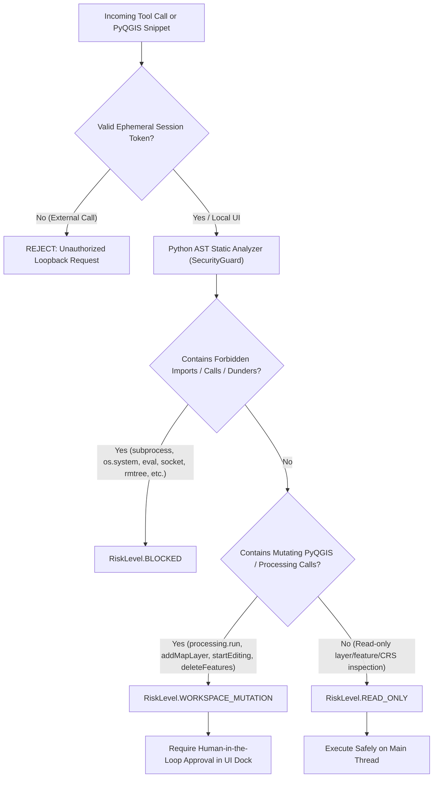

# Technical Specification: Ultra-Low Token Context Protocol & AST Security Sandbox

## 1. Design Goals

1. **Sub-150 Token Workspace Context**: Eliminate the common anti-pattern of serializing verbose JSON schemas or raw GeoJSON features into LLM prompts.
2. **Delta-Only State Transmission**: Compute a deterministic SHA-256 digest of each opted-in layer's metadata so subsequent turns transmit `"status": "UNCHANGED"` (consuming ~12 tokens) unless layers or selections actually change.
3. **First-Class `EPSG:5253` (TUREF / TM30) Governance**: Automatically detect CRS mismatches against the project standard (`EPSG:5253`) and expose deterministic reprojection tools without hallucinating coordinate transformations.
4. **Defense-in-Depth Security**: Combine an AST static code analyzer, operation risk classification, human-in-the-loop confirmation, and an ephemeral localhost (`127.0.0.1`) session token.

---

## 2. Ultra-Low Token Compact Context Protocol (`compact_context.py`)

### 2.1 Compact Micro-DSL Schema
Instead of sending verbose JSON keys (`"layer_name"`, `"geometry_type"`, `"coordinate_reference_system"`, `"feature_count"`, `"attributes": [{"name": ..., "type": ...}]`), `CompactContextBuilder` packs each user-approved layer into a single compact record:

```json
{
  "v": 1,
  "p_crs": "EPSG:5253",
  "std_crs": "EPSG:5253",
  "crs_ok": true,
  "hash": "a94f82c1d0e8b712",
  "layers": [
    {
      "id": "parseller_101",
      "n": " Kadastro_Parselleri",
      "t": "V:Polygon",
      "crs": "EPSG:5253",
      "ok5253": true,
      "fc": 1420,
      "sel": 0,
      "ext": [498120.5, 4412300.0, 499450.2, 4413890.8],
      "f": ["ada:int", "parsel:int", "alan_m2:real", "malik:str"]
    }
  ]
}
```

### 2.2 Token Budget Math
* A standard 5-layer GIS project serialized in traditional verbose JSON + sample features consumes **1,800 to 4,500 tokens**.
* The same 5-layer project in `qgis_lite_agent` Compact Context consumes **~95 to 135 tokens** on the initial turn.
* On Turn 2+ (when no layers have been added/removed or modified), `build_delta_context(previous_hash)` returns:
  ```json
  {"v": 1, "delta": "UNCHANGED", "hash": "a94f82c1d0e8b712", "p_crs": "EPSG:5253", "crs_ok": true}
  ```
  This consumes **~18 tokens**—a **98.5% token reduction**.

### 2.3 Strict Zero-Hallucination Policy
* `CompactContextBuilder` reads live values exclusively from `QgsProject.instance()`, `QgsMapLayer`, `QgsVectorLayer.featureCount()`, and `QgsRasterLayer.width()/height()`.
* If a layer is invalid or unreadable, it is explicitly flagged `"valid": false` rather than fabricating fallback values.
* Sample values (when explicitly requested via `include_samples=True`, capped at `max_samples=3`) are truncated to 32 characters per attribute and stripped of geometry WKT/GeoJSON to protect token budgets and data privacy.

---

## 3. AST Static Security Sandbox (`security_guard.py`)



### 3.1 Forbidden AST Constructs (`RiskLevel.BLOCKED`)
The `AstSecurityVisitor(ast.NodeVisitor)` walks every node of the parsed syntax tree before any byte of code is compiled or executed:
1. **Forbidden Modules**: `subprocess`, `shutil`, `socket`, `http`, `urllib`, `requests`, `ftplib`, `telnetlib`, ` ctypes`, `multiprocessing`, `pickle`, `marshal`, `importlib`, ` builtins`, `sys`, `pty`, `winreg`.
2. **Forbidden Built-in & OS Calls**: `eval()`, `exec()`, `compile()`, `__import__()`, `open()` (unless strictly reading within approved project directory, blocked by default in raw snippets), `os.system()`, `os.popen()`, `os.remove()`, `os.unlink()`, `os.rmdir()`, `os.spawn*()`.
3. **Forbidden Introspection Dunders**: `__subclasses__`, `__globals__`, `__builtins__`, `__code__`, `__closure__`, `__bases__`, `__mro__` (prevents sandbox escape attacks).

### 3.2 Mutating vs. Read-Only Classification
* **`RiskLevel.READ_ONLY`**: Expressions that only query `iface.mapCanvas()`, `QgsProject.instance().mapLayers()`, `.crs()`, `.fields()`, `.featureCount()`, `.getFeatures()` (bounded), or `QgsExpression` evaluation.
* **`RiskLevel.WORKSPACE_MUTATION`**: Any call to `processing.run`, `processing.runAndLoadResults`, `startEditing`, `commitChanges`, `addFeature`, `deleteFeature`, `changeAttributeValue`, `addMapLayer`, `removeMapLayer`, `setCrs`, or `QgsVectorFileWriter`. In interactive mode, these require explicit user approval in the **Human-in-the-Loop Action Review** box.

### 3.3 Loopback Binding & Session Authentication
* The MCP / Agent bridge socket binds exclusively to `127.0.0.1` (IPv4 loopback) and rejects non-loopback peers.
* At plugin startup (or bridge start), `SecurityGuard` generates a 128-bit cryptographic session token via `secrets.token_hex(16)`.
* Every JSON-RPC request over the loopback socket must include `"auth_token": "<token>"` (matched via constant-time `hmac.compare_digest`), preventing cross-site request forgery (CSRF) or unauthorized local processes from driving QGIS.
