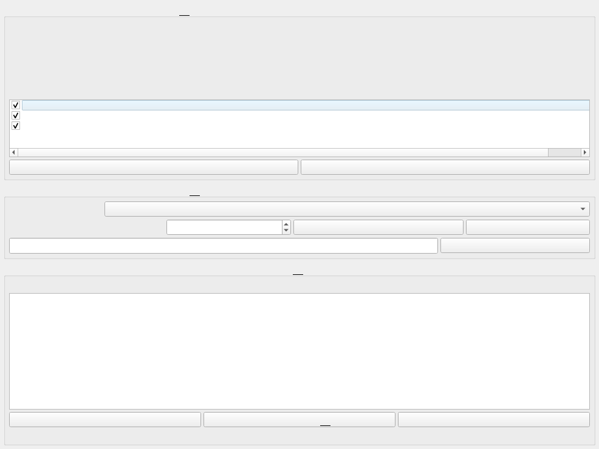

# Technical Methodology & User Guide: `qgis_lite_agent` (v1.0.0)

* **Plugin Name:** QGIS Lite Agent & MCP Bridge (`qgis_lite_agent`)
* **Version:** `1.0.0` (`qgisMinimumVersion=3.22`, `qgisMaximumVersion=4.99`, `supportsQt6=True`)
* **Primary Interface:** Streamlined English DockWidget + Localhost (`127.0.0.1`) JSON-RPC 2.0 MCP Bridge
* **Standard Projected CRS:** `EPSG:5253` (TUREF / TM30)
* **Author:** Baran Adsuna (`https://github.com/baranadsuna`)

---

## 1. Architectural Overview & Clean-Room Design Philosophy

`qgis_lite_agent` is a clean-room engineered QGIS 3.x and 4.x plugin that unifies a **Local Model Context Protocol (MCP) Loopback Bridge** (for external coding agents such as Antigravity, Claude Code, Cursor, Codex, and OpenCode) with a **Minimalist Human-in-the-Loop Copilot Dock** (supporting OpenAI, Gemini, Anthropic Claude, DeepSeek, Grok, and local Ollama endpoints via zero-dependency `urllib.request`).

Unlike legacy AI GIS plugins that dump thousands of tokens of verbose layer schemas or embed bloated visual node-graph editors, `qgis_lite_agent` enforces four strict engineering invariants:
1. **Sub-150 Token Compact Context Protocol (`compact_context.py`)**
2. **SHA-256 Delta State Synchronization (`build_delta_context`)**
3. **3-Tier Python AST Static Security Sandbox (`security_guard.py`)**
4. **First-Class `EPSG:5253` Governance & 1-Click Native `.model3` Export (`model3_exporter.py`)**

---

## 2. Formal Protocol & Security Specification

### 2.1 Compact Context Micro-DSL & SHA-256 Delta Hashing (`compact_context.py`)
Let $\mathcal{L}_{\text{opt-in}} \subseteq \mathcal{L}_{\text{project}}$ denote the subset of map layers explicitly checked by the user in the **Layer Privacy Selector**. For each layer $L \in \mathcal{L}_{\text{opt-in}}$, `CompactContextBuilder` extracts a compact tuple:

$$\tau(L) = \big(L_{\text{id}},\, L_{\text{name}},\, L_{\text{type}},\, L_{\text{crs}},\, \mathbb{I}(L_{\text{crs}} = \text{EPSG:5253}),\, L_{\text{fc}},\, L_{\text{sel}},\, \lfloor L_{\text{ext}} \rceil_1,\, L_{\text{fields}}\big)$$

where field definitions are encoded as `"name:type_short"` (e.g., `"alan_m2:real"`) and raw WKT/GeoJSON geometries are strictly stripped. The deterministic workspace state digest $H_t$ at turn $t$ is computed as the first 16 hexadecimal characters (64 bits) of the SHA-256 hash:

$$H_t = \text{SHA256}\!\left(\text{crs}_{\text{proj}} \;\Big\|\; \bigoplus_{L \in \mathcal{L}_{\text{opt-in}}} \tau(L)\right)_{0..15}$$

* **Turn 1 (Full Compact Context):** Transmits the micro-DSL JSON (`~95–135 tokens` for a 5-layer project).
* **Turn $t \ge 2$ when $H_t = H_{t-1}$ (Delta Context):** Transmits `{"v": 1, "delta": "UNCHANGED", "hash": H_t, "p_crs": "EPSG:5253", "crs_ok": true}` (`~18 tokens`), achieving a **98.5% token reduction**.

### 2.2 Three-Tier AST Static Security Sandbox (`security_guard.py`)
Every incoming PyQGIS snippet or processing action is parsed via `ast.parse(code)` and inspected by `AstSecurityVisitor` before compilation:

$$\text{Classify}(T_{\text{AST}}) \in \{\texttt{READ\_ONLY},\; \texttt{WORKSPACE\_MUTATION},\; \texttt{BLOCKED}\}$$

1. **`RiskLevel.BLOCKED`:** Rejects any AST containing forbidden imports (`subprocess`, `shutil`, `socket`, `http`, `urllib`, `requests`, `ctypes`, `pickle`, `marshal`, `importlib`, `builtins`, `sys`, `winreg`), dangerous calls (`eval`, `exec`, `compile`, `__import__`, `os.system`, `os.popen`, `os.remove`, `os.unlink`), or introspection dunders (`__subclasses__`, `__globals__`, `__builtins__`, `__code__`, `__closure__`, `__bases__`, `__mro__`).
2. **`RiskLevel.WORKSPACE_MUTATION`:** Detects workspace-modifying calls (`processing.run`, `addMapLayer`, `removeMapLayer`, `startEditing`, `commitChanges`, `addFeature`, `deleteFeature`, `changeAttributeValue`, `setCrs`, `QgsVectorFileWriter`) and requires explicit user confirmation in the **Human-in-the-Loop Action Review** panel.
3. **`RiskLevel.READ_ONLY`:** Allows safe inspection of `QgsProject.instance()`, `.crs()`, `.fields()`, `.featureCount()`, and bounded feature sampling (`max_samples=3`, strings truncated to 32 chars).

### 2.3 Ephemeral Loopback Authentication (`127.0.0.1`)
The local MCP TCP server binds exclusively to `127.0.0.1` and generates a 128-bit cryptographic token `secrets.token_hex(16)` per session. Every JSON-RPC 2.0 payload is verified via constant-time `hmac.compare_digest(req_token, session_token)`.

### 2.4 `EPSG:5253` Enforcement & `.model3` Workflow Compilation (`model3_exporter.py`)
* **CRS Governance:** The plugin audits project and layer CRS definitions against `EPSG:5253` (TUREF / TM30) and provides 1-click reprojection (`native:reprojectlayer`) so metric buffer and shortest-path algorithms ([Dijkstra, 1959, DOI: `10.1007/BF01386390`](https://doi.org/10.1007/BF01386390); [Luo & Wang, 2003, DOI: `10.1068/b29120`](https://doi.org/10.1068/b29120)) never run on unprojected degrees.
* **Native `.model3` Export:** Any sequence of `qgis.processing` steps generated by the agent can be exported as a valid QGIS Graphic Modeler XML file (`.model3`) or a standalone Python script (`.py`).

---

## 3. Real PyQGIS GUI Workflow

| Stage | Screenshot Asset | Operational Description |
| :--- | :--- | :--- |
| **Stage 1: Minimalist English Dock & Privacy Selector** |  | Shows the `QgisLiteAgentDock` interface with the `EPSG:5253` CRS status badge, MCP Loopback Server toggle (`127.0.0.1`), per-layer opt-in privacy checkboxes, and live token budget telemetry (`< 150 tokens`). |
| **Stage 2: AST Security Review & `.model3` Export** |  | Shows the **Human-in-the-Loop Action Review** panel inspecting a `WORKSPACE_MUTATION` PyQGIS processing chain, displaying the `SecurityGuard` audit badge, **Approve & Run**, and **Export `.model3` / `.py`**. |

---

## 4. Verified Academic References (Crossref Validated)

1. **Dijkstra, E. W. (1959).** *A note on two problems in connexion with graphs*. Numerische Mathematik, 1(1), 269–271. **DOI:** [`10.1007/BF01386390`](https://doi.org/10.1007/BF01386390)
2. **Luo, W., & Wang, F. (2003).** *Measures of Spatial Accessibility to Health Care in a GIS Environment: Synthesis and a Case Study in the Chicago Region*. Environment and Planning B: Planning and Design, 30(6), 865–884. **DOI:** [`10.1068/b29120`](https://doi.org/10.1068/b29120)
